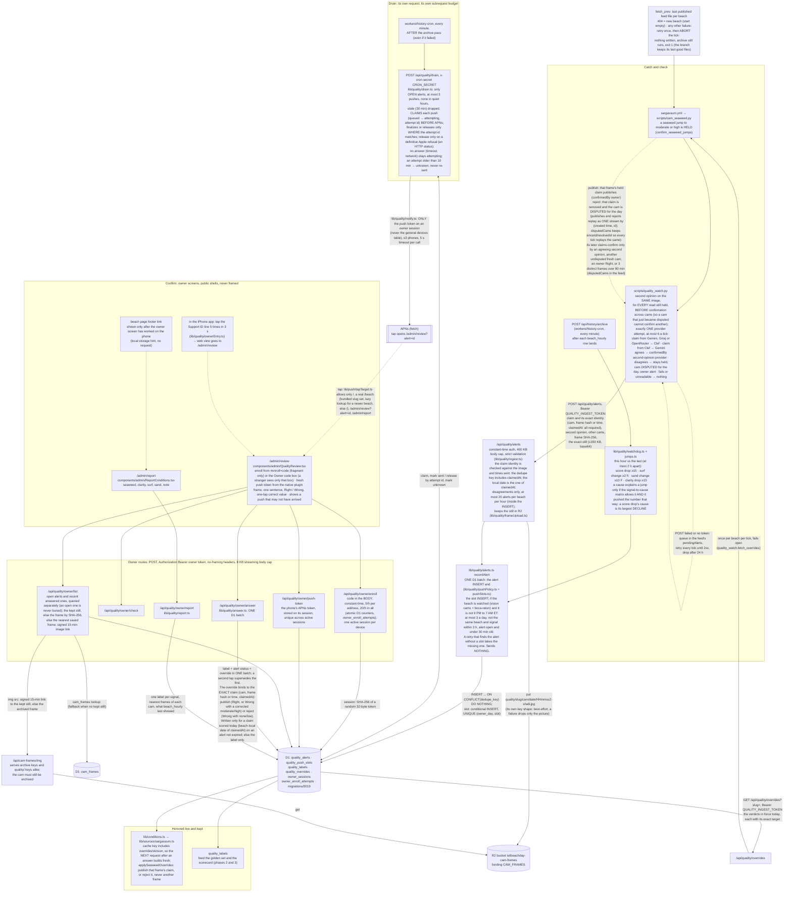

# Backend architecture — Is It Beach Day

This map shows every backend part and how it connects: the request path a
page or the app takes, the scheduled jobs that keep data fresh, and the Beach
Day Plus alert pipeline. Update this file in the same commit as any change
that adds, removes, or rewires a part.

Hosting: **Cloudflare Workers**, built with OpenNext (`npm run deploy`). See
`docs/HANDOFF.md` for the deploy command and owner to-dos. `wrangler.jsonc` `main`
is `worker.ts`, a thin wrapper around OpenNext's generated `.open-next/worker.js`
(it re-exports every named export, such as the Durable Object classes) that sends
the agent paths as complete bodies with a `Content-Length`; see
`docs/AGENT_API.md`, "Worker entry".

## 1. Request path — a page or app call

Every beach page and the app both go through the same conditions pipeline.
The pipeline fetches ~18 external sources in parallel, derives metrics, and
scores the result; the response is cached so a burst of visitors doesn't
re-run all of that per request.

```mermaid
flowchart TD
  subgraph client [Browser / iOS / Android app]
    PAGE[Beach page] 
    APPUI[App dashboard]
  end

  PAGE --> COND
  APPUI --> COND
  WATCH["Apple Watch app + complications"] -->|"GET, no query; Cache-Control s-maxage hint of 60 s at most (no Workers Cache), payload has validUntil"| WATCHR
  APPUI -->|"WatchSync plugin: home beach + last viewed<br/>lib/watchSync.ts (WatchConnectivity)"| WATCH

  EDGE["Worker entry worker.ts (wrangler main), lib/workerWrap.ts:<br/>wraps OpenNext's .open-next/worker.js. For /mcp, /api/v1/*, /api/watch/*, /llms.txt only:<br/>buffer the body, send Content-Length, drop Next's Vary: rsc tokens.<br/>Every other path passes through untouched (streaming pages stream)"]
  PAGE --> EDGE
  APPUI --> EDGE
  EDGE --> routes

  subgraph routes [HTTP routes]
    COND["/api/conditions/[slug]"]
    WATCHR["/api/watch/[slug]<br/>(small ready-to-show view for the Apple Watch app)"]
    SHARE["/api/share/[slug]<br/>(shareable social card PNG, story/square)"]
    RESOLVE["/api/resolve<br/>(name/zip → nearest served beach)"]
    OG["/opengraph-image, /twitter-image"]
    SITEMAP["/sitemap.xml"]
    CAM["/api/cam/[id]<br/>(proxied still frame)"]
    ADMIN["/api/admin/add, /api/admin/preview<br/>(owner-only, add a beach)"]
    STICKER["/sticker?s=&lt;tag&gt;<br/>(QR landing: count scan, set ref cookie, 307 → /?ref=tag)"]
    GETAPP["/get-app<br/>(count the store tap, 307 → App Store)"]
    ADMINSCANS["/api/admin/scans<br/>(owner-only, read the sticker funnel)"]
    VERSION["/api/version<br/>(deployed git SHA, no-store)"]
    OPENR["/api/open<br/>(once a day per device: count an app open)"]
    V1["/api/v1/beaches, /api/v1/beaches/[slug], /api/v1/beaches/[slug]/outlook, /api/v1/nearest<br/>(public read-only JSON for apps and assistants:<br/>CORS *, no cookies, no Plus or device data, no cam images)"]
    OPENAPI["/api/v1/openapi.json<br/>(OpenAPI 3.1, hand-written in lib/agent/openapi.ts;<br/>a test checks it against the route files)"]
    LLMS["/llms.txt<br/>(plain-text guide: what the app is, endpoints, MCP URL,<br/>credit and usage rules; built from lib/agent/constants.ts)"]
    MCPR["/mcp<br/>(remote MCP server, Streamable HTTP, STATELESS:<br/>JSON-RPC over POST (one message or a batch), 32 KB body cap,<br/>buffered replies with Content-Length, GET/DELETE = 405)"]
  end

  AGENTS["Assistants (Claude, ChatGPT) and developer apps"] -->|"POST JSON-RPC: initialize, tools/list, tools/call<br/>(custom connector URL)"| MCPR
  AGENTS -->|"GET; payload has validUntil; Cache-Control is a hint only,<br/>no Workers Cache; /nearest is no-store"| V1
  AGENTS --> OPENAPI
  AGENTS --> LLMS
  V1 -->|"every request, before any work"| RATELIMIT
  MCPR -->|"every request, before any work"| RATELIMIT["lib/agent/rateLimit.ts, per IP, two budgets:<br/>REST 60/min (binding AGENT_RATE_LIMITER), MCP 300/min (AGENT_MCP_RATE_LIMITER),<br/>else an in-isolate token bucket. No KV, no Durable Object"]
  V1 -->|"one counter line per request:<br/>route, status, user-agent family. No IP, no coordinates"| CFLOGS[(Workers logs)]
  MCPR --> CFLOGS
  V1 --> AGENTQ
  V1 -->|"outlook: one beach, ONE build at most"| OUTLOOK["lib/agent/outlook.ts<br/>1-3 day outlook from multiDayWindows (the dashboard's<br/>'best beach times for the next few days')"]
  MCPR -->|"get_beach_outlook"| OUTLOOK
  OUTLOOK -->|"loadPublicConditions: shared 120-s conditions cache or one build"| WATCHLOAD
  MCPR -->|"tools: list_beaches, get_beach_score,<br/>find_nearest_beach, best_beach_today"| AGENTQ["lib/agent/queries.ts + beachView.ts<br/>one read path for REST and MCP;<br/>scores read from recent views, at most ONE cold build per request"]
  AGENTQ -->|"beach directory + nearest to the shoreline"| LOC
  AGENTQ -->|"loadWatchView, cacheOnly for all but one beach<br/>(peek never builds or writes); summary, attribution, safety note added on top"| WATCHLOAD

  APPUI -->|"once per calendar day, on load + resume<br/>lib/useAppOpenPing.ts"| OPENR
  OPENR -->|"app_opens (hashed id)"| OPENS[lib/db/appOpens.ts<br/>daily active users]

  APPUI -->|"poll on resume, throttled 60s<br/>lib/useReloadOnNewVersion.ts"| VERSION
  VERSION -->|"served SHA ≠ baked SHA<br/>→ location.reload()"| APPUI

  STICKER -->|"scan_log + scan_claim"| FUNNEL[lib/db/scanFunnel.ts<br/>scan → tap → install]
  GETAPP -->|"scan_tap, claim marked tapped"| FUNNEL
  ADMINSCANS --> FUNNEL

  COND --> PIPE[lib/conditions.ts<br/>fetch all sources in parallel]
  WATCHR --> WATCHLOAD["lib/watchLoad.ts<br/>loadWatchView: fetch, refuse a partial build (budgetAborted),<br/>strip internal fields, build the view, cache seconds<br/>(one code path for watch, tablet and agents)"]
  WATCHLOAD --> PIPE
  WATCHLOAD -->|"after every successful build: store the compact view,<br/>max-age = time to validUntil, never partial or expired. No KV writes"| WVCACHE[("Workers Cache API caches.default<br/>key https://cache.isitbeachday.internal/watchview/&lt;slug&gt;/&lt;owner-override fingerprint&gt;<br/>per datacenter, lib/watchViewCache.ts")]
  WVCACHE -.->|"cacheOnly peek: match() only, accepted while validUntil is in the future"| WATCHLOAD
  WATCHR -->|"lib/watchView.ts: score + best window as the dashboard;<br/>safety lines from lib/safetyBanner.ts, the module SafetyBanner renders"| SCORE
  SHARE --> PIPE
  PIPE --> SOURCES[lib/sources/*<br/>one adapter per external source<br/>each returns Wrapped&lt;T&gt;, never throws]
  PIPE --> SCORE[lib/score.ts<br/>deriveMetrics + computeScore<br/>hourly + multi-day windows]
  SOURCES -->|"NWS alerts (onset/effective/ends)<br/>+ per-period SRF words +<br/>NOAA rip model (rip-data branch)"| RIPRISK["lib/ripRisk/*<br/>resolveRipNow: alert-in-effect (always High) &gt;<br/>fresh NOAA model (softened vs. a disagreeing<br/>SRF word, or upgrade-only once aging) &gt;<br/>current SRF period &gt; unknown — pure, now-passed"]
  RIPRISK -->|"rip cap (85/92)"| SCORE
  RIPRISK -.->|"in-effect alert only, deduped by CAP id"| EVAL2[lib/alerts/evaluate.ts<br/>snapshotHazards rip push]
  SCORE --> HAZ[lib/hazards/assess.ts<br/>one lightning + rain assessment<br/>30-min / 20-min holds, pure]
  SCORE --> CACHE[(NEXT_INC_CACHE_KV<br/>OpenNext page/data cache)]
  PIPE --> CACHE
  CAM --> SOURCES
  SHARE --> CARDMODEL[lib/shareCard.ts<br/>pick + format the on-card tiles]
  CARDMODEL --> IMG[next/og ImageResponse<br/>satori + resvg → PNG, default font only]

  PIPE --> SKYADAPT["lib/sources/launchLibrary.ts, kingTide.ts<br/>read launch-data / king-tide-data branches (section 2)"]
  PIPE --> SKYLIVE["lib/sources/moonEvents.ts (astronomy-engine, server-only)<br/>+ meteorShowers.ts (static yearly calendar)"]
  SKYADAPT --> SKYBUILD[lib/skyEvents.ts<br/>buildComingUp: merge tide+moon+meteor+launch,<br/>episode-group, 3-row cap w/ reserved rare row]
  SKYLIVE --> SKYBUILD
  SKYBUILD -->|"rates each event's own window"| SKYQUAL[lib/skyVisibilityQuality.ts<br/>clear-sky-best curve; hard caps: rain/fog/heavy low cloud;<br/>moonlight penalty &gt;70% lit]
  SKYBUILD -->|"card, always ≤3 rows"| SKYCARDUI[components/SkyEventsCard.tsx<br/>full-width dashboard row]
  SKYBUILD -.->|"uncapped alertCandidates<br/>SERVER-ONLY, stripped before any public response"| SKYALERT[snap.skyAlertCandidates]
  SKYCARDUI -.-> APPUI
  SKYCARDUI -.-> PAGE

  RESOLVE --> LOC[config/locations.ts<br/>source of truth for served beaches]
  SITEMAP --> LOC
  LOC --> NEAREST[lib/location/nearest.ts<br/>nearestServedBeach / rankBeaches]
  NEAREST --> SHOREDIST[lib/location/shoreDistance.ts<br/>distance to closest point on a beach's<br/>shore polyline, falling back to its pin]
```

On the Plus side, the app also calls the device/presence routes directly
(see diagram 3). `lib/location/nearest.ts` and its `shoreDistance.ts` helper
are also what `/api/hazards` and Beach Mode's arrival check (`establishesArrival`,
`lib/plus/beachMode.ts`) use to decide "which beach" / "am I at the beach" —
one shared rule, client and server.

**The agent surface: JSON API, OpenAPI, llms.txt and a remote MCP server.**
Assistants and apps read the same answer the website and the Apple Watch show.
`lib/watchLoad.ts` is the one loader behind `/api/watch/[slug]`, `/api/v1/*` and
the MCP tools: it fetches the conditions, refuses a partial build, strips
internal fields and builds the view (`lib/watchView.ts`). `lib/agent/beachView.ts`
adds the page link, a one-sentence summary, the attribution and the safety note
("Lifeguard flags and posted warnings always win."). `lib/agent/queries.ts` holds
the list and nearest logic once, so REST and MCP cannot disagree. `/mcp` is a
hand-written, stateless JSON-RPC handler (`lib/agent/mcp/server.ts`, spec
2025-11-25, 2025-06-18 and 2025-03-26): no session id, no Durable Object, no KV.
Every reply is buffered with a `Content-Length` (never chunked); a client that
accepts only `text/event-stream` gets one SSE event. Rate
limits run per IP before any work, as two budgets: REST 60 a minute and MCP 300 a minute, each
a Workers Rate Limiting binding (`AGENT_RATE_LIMITER`, `AGENT_MCP_RATE_LIMITER`
in wrangler.jsonc `ratelimits`) when bound, else an in-isolate token bucket.
`initialize` echoes a client revision we serve, else answers the latest.
`MCP-Protocol-Version` is ignored on `initialize`, optional after it, and a
present value must be a served revision (400 otherwise). `/mcp` checks `Origin`
before the rate limiter. `lib/agent/outlook.ts` serves the 1-3 day outlook
(`get_beach_outlook` and `/api/v1/beaches/{slug}/outlook`) from the same
multi-day windows the dashboard shows, through `loadPublicConditions` in
`lib/watchLoad.ts` (one beach, at most one build). Automatic Workers Cache is not enabled, so `Cache-Control`
on the answers is only a hint. The protection for the data sources is a rule: a
request builds at most ONE beach cold (about 25 subrequests; Workers Free allows
50). Every other beach in a comparison or a scored nearest list is read with
`peekWatchView` (`lib/watchViewCache.ts`): a `caches.default.match` for the
compact view that `loadWatchView` stored when it last built that beach, kept
only until its `validUntil` and keyed by the owner-override fingerprint, so an
owner correction drops it. The first uncached beach is the one built. The peek builds nothing and writes nothing, and a
beach it cannot find is reported as not compared right now. Expiry is checked
again with the live clock right before any score is served or ranked; an
expired reading is never served (503 for a single beach). No KV writes; the
store is per datacenter and does nothing where `caches` does not exist.
Setup and examples: `docs/AGENT_API.md`.

## 2. Scheduled jobs — keeping the feeds current

Two kinds of scheduler: **GitHub Actions** (free compute, runs scripts, writes
to data branches or calls the app) and **Cloudflare Cron Triggers** (run
inside a Worker, call the app's own API).

```mermaid
flowchart LR
  subgraph gh [GitHub Actions — .github/workflows]
    LGT["lightning.yml — GLM Lightning Feed<br/>~1-min reads in ~5.5h loops, each loop dispatches the next<br/>(*/10 cron = fallback)"]
    GOES["goes-cloud.yml — GOES Cloud Feed<br/>15-min reads from earliest sunrise − 75 min to latest sunset + 45 min<br/>(scripts/goes_cloud.py --window-state), idles overnight;<br/>Clear Sky Mask + ACHA 2 km cloud-top height → low/mid/high split and the sun-path read;<br/>~340-min loops, each dispatches the next (*/15 cron = fallback)"]
    MRMS["mrms.yml — MRMS Radar Rain Nowcast<br/>10-min reads around the clock;<br/>~340-min loops, each dispatches the next (*/10 cron = fallback)"]
    SARG["sargassum.yml — Cam Vision Feed<br/>10-min reads 5:55a-8:05p ET, idles overnight;<br/>~340-min loops, each dispatches the next (hourly cron = fallback that waits pending behind a live loop and never cancels it);<br/>feed frames already scored are skipped (frameShas)"]
    RIPNWPS["rip-nwps.yml — NOAA Rip Current Model Feed<br/>every 3h"]
    EVAL["eval.yml — Vision Eval<br/>every 2h, daylight"]
    PUSHCRON["push-cron.yml — Push notifications cron<br/>hourly at :05 (backstop)"]
    LAYOUT["layout-check.yml — Mobile Layout Check<br/>on push + PR"]
    LAUNCHLIB["launch-library.yml — Rocket Launch Feed (LL2)<br/>~30-min polls in ~4h45m loops, each dispatches the next<br/>(hourly cron = fallback)"]
    KINGTIDE["king-tide.yml — King Tide / High-Tide-Flooding Feed<br/>twice weekly, Mon + Thu"]
  end

  subgraph cf [Cloudflare Cron Triggers]
    PLUSCRON["workers/plus-cron<br/>*/5 min"]
    UWFRAME["workers/uw-frame<br/>multi-cam frame courier + Deerfield & Fort Lauderdale flag readers<br/>top of each hour, 10a-11p ET"]
  end

  subgraph mac [Owner's Mac — launchd, not a scheduler above]
    CAMCOURIER["scripts/cam_courier_local.sh<br/>hourly at :07, plus every 10 min inside the sunrise/sunset golden windows<br/>(--golden-only, scripts/golden_now.py), residential IP"]
    SUNCAM["scripts/sun_cam_check.py<br/>every 30 min, residential IP<br/>(YouTube blocks datacenter IPs)"]
  end

  CAMCOURIER -->|"POST /ingest?cam=&lt;id&gt;<br/>Bearer token, JPEG bytes"| UWFRAME

  LGT -->|writes| LDATA[(lightning-data branch)]
  SARG -->|reads| VCAMS[config/vision-cams.json<br/>per-beach cam registry]
  SARG -->|writes| SDATA[(sargassum-data branch<br/>cam_seaweed.&lt;slug&gt;.json, one per beach)]
  RIPNWPS -->|reads| NWPSMAP[config/nwpsRip.ts<br/>beach → NWS office + nearest model grid point,<br/>built by scripts/nwps_rip_map.mjs]
  RIPNWPS -->|"downloads each mapped office's<br/>NOAA NWPS CG1 ripprob file ONCE"| NOMADS[["nomads.ncep.noaa.gov<br/>NWPS rip current model (Dusek &amp; Seim 2013)"]]
  RIPNWPS -->|writes| RDATA[(rip-data branch<br/>rip_nwps.json — its OWN branch, NOT<br/>sargassum-data, which sargassum.yml/<br/>backfill-pct.yml force-push as an orphan<br/>and would silently wipe it)]
  GOES -->|"anonymous S3 reads: ABI-L2-ACMC mask + ABI-L2-ACHA2KMC height,<br/>newest scan present in both"| NOAAS3[["NOAA GOES-19 on AWS Open Data<br/>noaa-goes19.s3.amazonaws.com"]]
  GOES -->|"writes goes_cloud.json v3 (single-commit orphan)"| GDATA[("cloud-data branch<br/>per beach: cloudPct, beamCloudPct, and ir = low/mid/high/irCloud shares<br/>+ a sun-path read per sunrise and sunset")]
  MRMS -->|writes| MDATA[(MRMS rain nowcast data)]
  EVAL -->|archives + scores stills| SDATA
  LAUNCHLIB -->|"paginated pull, throttle-aware (≤15 req/hour)"| LL2API[["Launch Library 2<br/>thespacedevs.com"]]
  LAUNCHLIB -->|"writes, single-commit orphan"| LLDATA[(launch-data branch<br/>launch_data.json)]
  KINGTIDE -->|"per-station hi/lo predictions + flood levels"| COOPSAPI[["NOAA CO-OPS<br/>tidesandcurrents.noaa.gov"]]
  KINGTIDE -->|"writes, single-commit orphan"| KTDATA[(king-tide-data branch<br/>king_tide_data.json)]

  LDATA --> SOURCES2[lib/sources/lightning.ts]
  SDATA --> SOURCES3[lib/sources/sargassum.ts, busyness.ts, clarity.ts]
  RDATA -->|rip_nwps.json| SOURCES6[lib/sources/ripNwps.ts<br/>per-beach hourly probability series,<br/>stale &gt;36h treated as unavailable]
  SOURCES6 --> RIPRESOLVE[lib/ripRisk/resolve.ts<br/>resolveRipNow: alert &gt; fresh model &gt; SRF forecast &gt; unknown]
  SOURCES3 -->|"last 2 weeks of read times"| CAMNEXT[lib/camNextRead.ts<br/>learns the next cam read time,<br/>no fixed schedule]
  GDATA --> SOURCES4["lib/sources/goesCloud.ts<br/>parses the v3 ir block (older feeds: ir null)"]
  SOURCES4 -->|"ir: used only if its scan is ≤20 min old<br/>and the event is ≤60 min away; else the forecast"| SUNALERT["lib/sunAlert.ts assembleSunEventQuality<br/>source: satellite-ir or forecast"]
  MDATA --> SOURCES5[lib/sources/precipRadar.ts<br/>parses lastWetIso → wetMinutesAgo<br/>on the server clock]
  LLDATA --> SOURCES7[lib/sources/launchLibrary.ts<br/>per-beach LaunchSkyEvent: bearing/distance,<br/>range-tier eligibility, day/twilight/night light state]
  KTDATA --> SOURCES8[lib/sources/kingTide.ts<br/>per-station flood-threshold + top-1%-of-year<br/>episodes, episode-merged]

  PUSHCRON -->|POST x-cron-secret| RUN["/api/push/run?mode=all"]
  RUN -->|"at-beach hazards read the SAME<br/>assessment the score caps use"| HAZ2[lib/hazards/assess.ts<br/>lightning from the device fix,<br/>rain from the beach radar or the fix's cell forecast]
  PLUSCRON -->|POST x-cron-secret, every 5 min| RUN
  HISTCRON["workers/history-cron<br/>Cloudflare Cron every minute;<br/>the 08:17 UTC tick also runs the cam purge"] -->|POST x-cron-secret| HIST["/api/history/archive<br/>ONE build per call (Workers Free = 50 subrequests/request;<br/>a cold build is ~25); scans candidates least-recently-archived first,<br/>claims (slug, hour_utc) with a 10-min abandonment window,<br/>reserves budget BEFORE building; one unit = one DIRECT build<br/>(getConditionsForLocation, never the 120-s cache)"]
  HIST -->|"one direct build per beach-hour (getConditionsForLocation,<br/>44-subrequest budget)<br/>daylight-only for auto beaches"| PIPE
  HIST -->|"beach_hourly (score as shown + inputs, plus extra_json:<br/>surf, sand, rip, storm, feels-like, water trend, vs-average,<br/>safety levels, best window, sky ratings, plus the scorecard inputs:<br/>rain nowcast + radar truth, lifeguard flags, days 1-6 outlook — lib/history/extra.ts),<br/>history_budget (free-tier guard, 600 builds/UTC-day;<br/>HISTORY_ENABLED=off pauses it)"| D1[(D1 isitbeachday-plus)]
  HIST -->|"sun_event_predictions (migrations/0013): the sunrise + sunset the card shows<br/>(event kept until its golden window closes — lib/sunCardEvent.ts, shared with the card),<br/>one row per beach per archive hour, score + every input, one multi-row upsert,<br/>same assembleSunEventQuality as the card and the alert; retried once inline,<br/>never fails the beach_hourly row; observed_* filled later by SUNOBS"| D1
  SDATA -->|"history[] + latest/morning per-cam reads, read through the same<br/>lib/sources/camFeed.ts URL resolver the live sources use"| HIST
  HIST -->|"cam_observations (every history[] read not yet stored: crowd, seaweed, water,<br/>clarity, underwater uw) + cam_reads (per-cam detail), migrations 0006/0014,<br/>INSERT OR IGNORE, vision-cam beaches only (config/vision-cams.json),<br/>lib/history/camObservations.ts; a feed failure never fails the beach_hourly row"| D1
  HIST -->|"quality watchdog, after the row lands (lib/quality/watchdog.ts, section 4):<br/>this hour vs the last; an unexplained jump in score, surf, sand or clarity<br/>becomes a quality_alerts row and, within the push rules, a QUEUED push slot (no APNs here); failure never fails the row"| D1
  HISTCRON -->|"after the archive pass, every tick: POST /api/quality/drain, x-cron-secret<br/>sends the queued owner pushes (section 4); a failed archive pass does not skip it"| QDRAIN["/api/quality/drain<br/>≤3 pushes, 5 s per APNs call, section 4"]
  SARG -->|"a held seaweed jump the second reader (Clef or Gemini) does not back:<br/>POST /api/quality/alerts, Bearer QUALITY_INGEST_TOKEN (section 4)"| QALERT["/api/quality/alerts<br/>owner alert + review screen, section 4"]
  BACKFILL["scripts/backfill_cam_history.mjs (one-shot; shares<br/>lib/history/camObservationRow.mjs with the archiver)"] -->|cam_observations| D1
  SARG -->|reads| ACAMS["config/archive-cams.json<br/>the 11 archived cams, generated from config/locations.ts<br/>by scripts/gen_archive_cams.ts (a cam with archive false is left out)"]
  SARG -->|"every tick, vision on or off: GET /api/cam-frames/slots?slug (one per beach, fails open)<br/>then POST /api/cam-frames?slug&amp;cam&amp;frameAt for cams not yet filled<br/>Bearer INGEST_TOKEN, raw JPEG, best-effort, 15 s timeout, 90 s budget per tick<br/>(scripts/cam_seaweed.py: the stills the vision loop fetched are uploaded after its reads,<br/>archive_pass fetches the rest; frameAt = latest.json timestamp or the uw-frame meta time)"| CAMINGEST["/api/cam-frames (POST) and /api/cam-frames/slots (GET)<br/>constant-time auth; cam must be in the manifest (404 unknown, 403 archive:false);<br/>Content-Length and streamed 600 KB cap; JPEG magic, at least 10 KB; sha-256;<br/>atomic slot claim with a random claim id = one shot per cam per slot of display time<br/>(slot = UTC hour; inside the beach golden-hour windows, sunrise -20/+40 min and sunset -40/+20 min, a 10-minute slot: lib/camFrames/golden.ts)"]
  CAMINGEST -->|"INSERT ... ON CONFLICT DO NOTHING (state pending, claim_id), else take over a pending claim older than 10 min;<br/>R2 put; then ready WHERE claim_id matches (an uncertain finalize is re-read, never rolled back blind);<br/>an unchanged sha vs the newest ready frame is dropped (advisory);<br/>cam_frames, migrations/0016 and 0017 (slot_kind)"| D1
  CAMINGEST -->|"PUT slug/cam/local_date/HHmmZ-sha8-claim8.jpg"| CAMR2[("R2 bucket isitbeachday-cam-frames<br/>binding CAM_FRAMES<br/>lifecycle rule deletes after 367 days")]
  HISTCRON -->|"once a day, on the 08:17 UTC tick, before the archive call; POST x-cron-secret"| CAMPURGE["/api/cam-frames/purge<br/>at most 10 D1 statements: pending rows older than 1 h,<br/>then rows older than 365 days by received_at_utc<br/>(DELETE of 5,000 rows per statement)<br/>also: push slots sent or unknown older than 30 days,<br/>owner enrollment counters older than 2 days"]
  CAMPURGE -->|"deletes cam_frames rows; R2 objects expire on their own two days later"| D1
  SARG -->|"fallback vision read, only when CLEF_FALLBACK=1 and both Gemini models fail (order: Gemini, Clef, Groq, OpenRouter):<br/>POST /api/vision/clef, Bearer INGEST_TOKEN, JSON {kind surface or underwater, base64 JPEG shrunk to 768 px / q60}<br/>(scripts/cam_seaweed.py; 30 s timeout, one attempt; 401, 429, 502, 503 = provider failed, the chain moves on to Groq;<br/>a frame Clef calls unreadable = NO reading: the chain stops and the cam is skipped this tick, no frameSha)"| CLEFAPI["/api/vision/clef (POST)<br/>constant-time auth; 400 KB streamed cap; AI binding present else 503;<br/>the backtest's questions and answer mapping (lib/vision/clef.ts), after a strict check of every probability, index and noul;<br/>502 on a model error, a malformed reply or a missing field, never an invented value;<br/>reply = the assess() reading shape + provider, model, usage, latencyMs;<br/>one log line per UTC day on the first success (model, kind, latency, tokens only)"]
  CLEFAPI -->|"env.AI.run(@cf/cloudflare/clef), Clef 27B only"| WAI[["Workers AI<br/>binding AI (wrangler.jsonc)<br/>Clef 27B @cf/cloudflare/clef"]]
  CLEFAPI -->|"one atomic statement per call: INSERT ... ON CONFLICT (day, model) DO UPDATE SET count = count + 1 WHERE count &lt; 600 RETURNING count;<br/>no row = 429 daily-cap; no DB binding or any DB error = 503, the model is not called<br/>(lib/vision/dailyCap.ts, migrations/0018)"| D1
  DAYUI["Plus day sheet<br/>components/plus/DayViewSheet.tsx<br/>behind DAY_VIEW_ENABLED (lib/plus/flags.ts)"] -->|"POST deviceId + date"| DAYAPI["/api/history/[slug]/day<br/>app only; rate limit, install token, entitled (free device = 403)<br/>3 D1 reads: archive bounds, that local day's beach_hourly rows, ready cam_frames rows;<br/>returns that date's golden-hour windows (computed, no read) and each shot kind;<br/>only cams still archived; credit read from each row;<br/>signs every shot link for 15 min with CAM_FRAME_URL_KEY"]
  DAYAPI -->|"SELECT only, no R2"| D1
  DAYUI -->|"img src = signed link"| IMGAPI["/api/cam-frames/img (GET)<br/>constant-time verify of k, exp, sig; cam still archived (else 403);<br/>streams the R2 object, private cache for the seconds the link has left;<br/>404 object gone, 503 no binding"]
  IMGAPI -->|"get"| CAMR2
  REMOVE["scripts/cam_archive_remove.ts (by hand; dry run unless --yes)<br/>lists the cam prefix through the R2 S3 API when R2 keys are set,<br/>wrangler r2 object delete + D1 DELETE for one cam"] -->|"erase one cam on a request"| CAMR2
  REMOVE --> D1
  SUNCAM -->|"yt-dlp -J → HLS playlist (~4 h DVR); one frame every 2.5 min,<br/>event −35 … +25 min, per config/sun-cams.json cam"| YTLIVE[["YouTube livestream DVR<br/>Elbo Room + 3 Deerfield cams, all facing east"]]
  SUNCAM -->|"POST /api/sun-observations — Bearer INGEST_TOKEN<br/>robust-peak score + series + scored_at, per beach / event / cam;<br/>incomplete captures are never sent"| SUNOBS["/api/sun-observations<br/>constant-time auth, bounded 32 KB read, strict validation<br/>that recomputes coverage + robust peak (lib/sunObservations.ts)"]
  OWNER["owner's Mac"] -->|"POST /api/push/test — Bearer INGEST_TOKEN, {deviceId}:<br/>one real APNs alert to one device, writes no alert state"| PUSHTEST["/api/push/test"]
  SUNOBS -->|"sun_event_observations (migrations/0015)<br/>upsert only when (score_version, scored_at) is newer —<br/>duplicates and stale replays are no-ops; credit stored"| D1
  SUNOBS -->|"observed_score / observed_source / observed_at on the<br/>sun_event_predictions rows (event within 15 min; best cam:<br/>solar view first, then nearest; never a hand label)"| D1
  SCORECARD["scripts/scorecard.ts — by hand or a weekly Claude scheduled task<br/>read-only wrangler SELECTs, then lib/scorecard/metrics.ts (pure maths)<br/>and report.ts (Markdown); never writes to D1"]
  D1 -->|"beach_hourly (extra_json blocks), sun_event_predictions,<br/>sun_event_observations, cam_observations"| SCORECARD
  SCORECARD -->|"docs/scorecards/YYYY-MM-DD.md + latest.md<br/>predicted vs what happened: sun color, rain, best window,<br/>safety vs flags, data health"| SCARDS[(docs/scorecards)]
  UWFRAME -->|one headless-Chrome launch/tick,<br/>reused across every cam + the flag read| UWKV[(UW_FRAME KV<br/>frame:&lt;id&gt;, meta:&lt;id&gt;,<br/>flags:deerfield-beach, flags:fort-lauderdale)]
```

**`workers/uw-frame` is a multi-cam courier, not a single grab.** Deerfield
Beach's cams (underwater, crowd/sand, surf, pier) plus Fort Lauderdale
Beach's Elbo Room cam (crowd/sand, owner approved) exist only as YouTube live
streams — there's no still-image feed — so each cron tick opens ONE headless
Chrome and reuses the SAME page across every camera due that tick (navigate
the embed, wait for it to actually be playing, screenshot, move to the next
cam) rather than launching a browser per camera. The same browser also loads
the City's public ArcGIS "Beach Conditions" dashboard once per daylight tick
to read which lifeguard flag(s) are currently flying — that dashboard shows
the active flag(s) by toggling block visibility rather than changing text, so
the reader records which of the five known blocks is actually visible. The
underwater cam still grabs hourly (unchanged); the three surface cams grab
every 3 hours in daylight only, and the flag read runs every daylight tick —
all three cadences, and the full per-day Browser Rendering time budget, are
decided in `workers/uw-frame/src/lib/schedule.ts` and documented in
`workers/uw-frame/src/index.ts`. Endpoints: `GET /frame[?cam=<id>]`,
`GET /meta[?cam=<id>]` (no `cam` = the underwater cam, unchanged legacy
keys), `GET /cams` (registry + each cam's last grab), and
`GET /flags?slug=deerfield-beach`, `GET /flags?slug=fort-lauderdale`.

**Fort Lauderdale lifeguard flags.** The City of Fort Lauderdale Fire Rescue posts a plain-text "Beach Conditions" page once a day (flags, sea-pest notes, ocean conditions, water temperature). A plain fetch gets a 403 bot-block, so `uw-frame` opens it in Browser Rendering on the same daylight-gated tick as the Deerfield read, reads `document.body.innerText`, parses it with the pure section parser `workers/uw-frame/src/lib/ftlConditions.ts`, and stores `flags:fort-lauderdale` in the same `{flags, observedAtUtc, ok}` shape `lib/sources/cityOfficial.ts`'s `mapFlagsFeed` expects, plus `pageDate`, `seaPests`, `seaPestsPresent`, `waterTempF`, `oceanConditions`. Because the City posts daily, a page more than 2 calendar days old (America/New_York) is written `ok:false`, which the app shows as "unknown" rather than a stale flag. A failed or stale read never overwrites a good stored one (the attempt lands under `flags-attempt:fort-lauderdale`). `seaPests` is captured but not yet shown in the UI.

As of September 2026, frames arrive from the owner's Mac courier
(`scripts/cam_courier_local.sh`, hourly at :07, plus every 10 minutes inside the golden-hour windows via the `--golden-only` launchd job, residential IP) via `POST /ingest`;
the Worker's own headless-Chrome grab remains as a fallback. YouTube now
blocks video playback from Cloudflare's browser fleet, so the Mac — a normal
home connection — grabs each frame and sends it to the Worker instead. Both
paths write through the same guard, so neither can overwrite the other's
newer good frame; `GET /cams` shows which path supplied each camera's
current frame in its `source` field ("courier" or "browser").

**The sun-cam check gives every sunrise and sunset a "what actually happened"
score.** `scripts/sun_cam_check.py` runs on the owner's Mac every 30 minutes
(`scripts/com.isitbeachday.suncam.plist`; YouTube blocks datacenter IPs, so it
cannot run in a Worker or Action). It reads the 24/7 east-facing livestreams in
`config/sun-cams.json`. YouTube keeps ~4 hours of DVR for each, so a run up to
3.5 hours after an event rebuilds it: one frame every 2.5 minutes from 35
minutes before to 25 minutes after the event, each scored 0-100 on how much of
the sky is lit warm. The event's score is a robust peak (a frame counts for at
most twice its best neighbor, so one glitch frame cannot win), and a capture
without enough frames before, around, and after the event is never uploaded. The result goes to
`POST /api/sun-observations` with the courier's `INGEST_TOKEN`, lands in
`sun_event_observations` (migrations/0015), and the best observation (solar view
first, then nearest cam) is copied onto the matching `sun_event_predictions`
rows. Sunrise views are `solar`, sunset views `antisolar`. Every stored row
carries the cam owner's credit string (Elbo Room asked for one). See
`docs/SUN_CAM_CHECK.md`.

**The scorecard closes the loop: predict, measure, score.**
`scripts/scorecard.ts` runs by hand or from a weekly Claude scheduled task
(`npx vite-node -c vitest.config.ts scripts/scorecard.ts`). It only reads D1,
through read-only `wrangler d1 execute --remote` queries, so it adds no route,
no job, and no write. It scores the sun-color forecasts against the cam
readings, the rain nowcast against the MRMS radar, the best-window and
multi-day outlook against the hourly scores the days really had, and the
swim-safety message against the lifeguard flags. Each system shows
"collecting" until it passes its minimum sample. The pure maths is
`lib/scorecard/metrics.ts`; the Markdown is `lib/scorecard/report.ts`. Reports
land in `docs/scorecards/` (see its `README.md`). The `rain`, `flags` and
`outlook` blocks of `beach_hourly.extra_json` exist for it.

**Feed loops relay to themselves.** GitHub's cron is best-effort — Sep 24-28
2026 it left loops unrestarted for hours (lightning 109 min with stale
lightning data; goes-cloud and the cam feed 4-5 h late every morning). So the
five looping feeds (`lightning`, `goes-cloud`, `mrms`, `sargassum`,
`launch-library`) each end with a small `handoff` job that dispatches the
next loop (`gh workflow run`, `actions: write` on that job only — GITHUB_TOKEN
may trigger `workflow_dispatch`, so no secret). It skips a cancelled run (a
newer run already replaced it under `cancel-in-progress`) and a loop that
ended within 15 min (no tight respawn cycle), and only runs on `main`. The two
daylight feeds idle overnight instead of exiting, so the first morning read
lands at ~06:00 ET (the first :00/:10/:15 grid point after the 05:55 window
opens), not whenever the cron next fires. Each workflow's own cron stays as the fallback if a run
dies before its handoff.

`push-cron.yml` and `plus-cron` both hit the same route — GitHub's schedule is
best-effort, so the Cloudflare cron is the reliable path and GitHub is the
backstop. `PUSH_SAFETY_ALERTS` (a Worker var) kills every hazard alert
app-wide without a deploy.

**Cam vision is per-beach.** `sargassum.yml` no longer reads one hard-coded
Boca cam list: `scripts/cam_seaweed.py` loads `config/vision-cams.json` (one
entry per beach, each with its own cams and a `kind` of `feed`,
`direct`, or `hls`) and processes every registered beach in the same run,
publishing one `cam_seaweed.<slug>.json` per beach to `sargassum-data`. A
`vitest` (`lib/visionCams.test.ts`) cross-checks the registry against
`config/locations.ts` so the two never drift apart. `lib/sources/camFeed.ts`
builds each beach's feed URL from `loc.slug`; `sargassum.ts` and `busyness.ts`
both use it, and Boca Raton alone falls back to the pre-split single-file
`cam_seaweed.json` (which the job still publishes as a copy, for one release)
if its own per-beach file isn't there yet. The underwater "Spinner the Sea
Cam" read stays a single per-run calibration signal — the same `uw` value is
copied onto every beach's file, not read once per beach. Three guards sit
between a vision read and the published file (no new parts, all inside
`cam_seaweed.py`): a **low-sun gate** (sun under `LOW_SUN_DEG`, default 10°, at
the frame's time publishes no seaweed or water for that cam, and the same check
at the tick's time blanks every cam in the group, carried ones too; crowd
stays), a **jump check** (a moderate/high seaweed read is held until the same
cam's next *different* frame, or another cam's *fresh* read in the same tick,
agrees; held claims live in `pendingClaims` until the end of their beach-local date, with
no minute limit, because Fort Lauderdale's single courier cam is read about every
3 hours, each frame can be read up to 150 minutes late, and runs are polled loosely;
a fresh read of that cam below moderate clears the claim at once), and an optional per-cam **`visionHint`** in `vision-cams.json` that is
added to the prompt for Gemini and the OpenAI-compatible providers (Clef is
untouched). Beach coordinates for the gate come from `config/archive-cams.json`.
The file also carries `lastSeaweed` and `lastWater` (today's newest capture with
a seaweed level / a water grade; kept apart because their validity diverges) and
`morning` (the 5 AM to noon capture with the most seaweed-level cams). Seaweed
readers pick `latest`, else `lastSeaweed`, else `morning`; water readers pick
`latest`, else `lastWater`, else `morning`, through `lib/camGroup.ts`, which also
rejects any group from another beach-local date or with an unreadable one
(seaweed: `latest` too), while busyness keeps `latest`. A fallback read, or any
read over 30 minutes old (a `latest` the producer kept because no cam had a new
frame), shows "as of 6:00 PM" on the dashboard and the share card (the share card's
cache expires at that 30-minute mark). One strict parser in `lib/camGroup.ts` reads
every capture stamp; an unreadable one is rejected, and clarity treats it as stale.
`pendingConfirmation` comes from open (unconfirmed, same-day) entries in the
feed's `pendingClaims`, whatever group the card shows, and a first-ever held
observation still returns an "unknown" reading so the flag reaches the alerts; it stops the
push copy saying "no seaweed" and holds back the "turned Excellent" alert until the
claim resolves.

**The webcam archive keeps one shot per cam per slot: one per hour, about one per 10 minutes in golden hour.** `scripts/cam_seaweed.py`
POSTs each cam's still to `/api/cam-frames` on every `sargassum.yml` tick, with
`INGEST_TOKEN`, after a cheap `GET /api/cam-frames/slots` check (one per beach)
that lets it skip cams whose hour is already stored. It sends the stills the vision loop already fetched, and
`archive_pass()` fetches the rest (the cams the vision reader never reads, plus
any courier cam it skipped), so archiving runs even with no vision provider.
The cam list is `config/archive-cams.json`, generated from
`config/locations.ts`: every cam with a proxied still whose `archive` flag is
not `false`. The slot is the UTC hour of the frame's display time, except inside the
beach's golden-hour windows (sunrise -20/+40 min, sunset -40/+20 min, from the
Sun panel's NOAA solver in `lib/camFrames/golden.ts`), where it is that time
floored to 10 minutes and the row's `slot_kind` is `golden` (migration 0017).
`GET /api/cam-frames/slots` applies the same rule and returns the windows, so the
script's pre-check asks about the slot a frame would really land in. The
workflow loop reads from the earliest sunrise -30 min to the latest sunset +30
min (`cam_seaweed.py --window-state`). The route claims the (beach, cam, slot) with one atomic
insert, writes the JPEG to the R2 bucket `isitbeachday-cam-frames` (binding
`CAM_FRAMES`), then marks the row ready in `cam_frames` (migration 0016). Every claim has a
random `claim_id` (its first 8 characters are in the R2 key); a pending claim
older than 10 minutes can be taken over, and finalize and rollback only act on
their own claim. If the ready update errors, the route re-reads the row before
touching R2, and leaves the object alone when D1 is unreachable. Each
row keeps three clocks: `received_at_utc` (server time, drives retention),
`frame_at_utc` (the source's own time, when believable) and `display_at_utc`
(what the user sees). The every-minute tick of `workers/history-cron` that
lands on 08:17 UTC also calls `/api/cam-frames/purge` first, then runs its
normal archive call. A purge failure never stops the archive call. There is no
second cron expression: the Workers Free plan allows 5 per account. The purge
drops rows older than 365 days, and the bucket's 367-day lifecycle rule removes
the objects. Setting `archive: false` on
a cam stops ingest at once; `scripts/cam_archive_remove.ts` erases what is
already stored. Plus reads the archive through two routes. `POST
/api/history/[slug]/day` is gated like `/api/history/[slug]` (app only, rate
limit, install token, then `entitled`). It runs three D1 reads (archive bounds,
the day's `beach_hourly` rows, the day's ready `cam_frames` rows), lists only
cams the manifest still archives, takes each credit line from the stored row,
and signs a 15-minute link per shot. `GET /api/cam-frames/img` checks that
signature in constant time, checks the cam is still archived, and streams the
object from R2 with a private cache header. A bad or expired signature is 403,
a missing object 404, a missing binding 503. The picker and sheet sit behind
the `DAY_VIEW_ENABLED` constant (`docs/CAM_ARCHIVE_PLAN.md`). The day
payload also carries that date's `golden` windows and each shot's `kind`, which
drive the sheet's Sunrise and Sunset buttons.

**NOAA's rip current model is preprocessed, not fetched live.** NOAA's NWPS
probabilistic rip current model (Dusek & Seim 2013) publishes one ~2.5MB text
file per NWS office, hourly, 6 days out — too big to fetch per page load.
`scripts/nwps_rip_map.mjs` is a one-time (re-runnable) script that, for every
beach in `listLocations()`, finds the covering NWS office via
`api.weather.gov/points` and the nearest model grid point (accepted only
within 3km of the shoreline), writing the static `config/nwpsRip.ts` —
currently 27 of 39 beaches (only coastal offices run the model). `rip-nwps.yml`
runs `scripts/rip_nwps.mjs` every 3h: for each DISTINCT office in the map, it
downloads that office's latest CG1 ripprob file ONCE (today 12z → 00z →
yesterday 12z → 00z, each fetch under a 20s abort timeout), extracts every
mapped beach's nearest point, and publishes a single small `rip_nwps.json`
(72h of hourly probability + wave/period/direction per beach) to its OWN
**`rip-data`** branch — deliberately NOT `sargassum-data`: that branch is
force-pushed as a single-commit orphan by both `sargassum.yml` (~every 10 min)
and `backfill-pct.yml`, which silently deletes anything else published there
(a prior version of this file lived on `sargassum-data` and was wiped
repeatedly). A downloaded run is only ACCEPTED if it sanity-checks (non-empty
grid, in-range probabilities, hourly coverage of `now..+24h` with no gaps);
one that fetches but fails those checks, or fails to fetch after one retry,
falls through to an older cycle and ultimately carries that office's beaches
forward from the previous publish with their ORIGINAL run time, never faking
freshness. Every row's `prob` is validated to [0, 100] (sentinels like
-999/9999 are dropped, not clamped) both in the job and again, defensively, in
the adapter.

`lib/sources/ripNwps.ts` reads that file (an in-flight promise shared by
concurrent callers, so a cold build fetching many beaches at once issues ONE
request; stale >36h = unavailable) and `lib/ripRisk/resolve.ts`'s
`resolveRipNow` folds it in: an alert actually IN EFFECT always resolves
HIGH; otherwise a model run ≤18h old can pull the result ONE band below a
disagreeing Surf Zone Forecast word (never further), a run 18-36h old can only
UPGRADE the SRF word, never downgrade it; with no fresh model, the SRF word
governs; with neither, unknown. (An earlier experimental wave/tide/wind
physics estimate was removed from this hierarchy — never wired past its own
tests — see `lib/ripRiskCurve.ts`, which is a separate, still-used system
that shapes the CARD's hourly curve for beaches with no model coverage.) The
dashboard's own clock ticks every 60s post-mount (matching `RipRiskCard`'s
convention) so this resolution — and the score's rip cap shown client-side —
stays live rather than freezing at whatever was true when the tab loaded.

**The "Coming up" sky-events card follows the same "preprocess, don't fetch
live" pattern.** `launch-library.yml` polls Launch Library 2 every 30
minutes, inside an hourly-triggered ~4h45m loop (the same GitHub-cron-
unreliability workaround as `lightning.yml`), and publishes `launch_data.json`
to its own `launch-data` branch. `king-tide.yml` runs twice a week — tide
predictions are deterministic astronomy, not a live model, so a fast cadence
buys nothing — and publishes `king_tide_data.json` to its own
`king-tide-data` branch. Each feed gets its own branch for the same reason
`rip-data` does: `sargassum-data` is force-pushed as an orphan branch by two
other jobs and would silently wipe anything else stored there. A failed or
partial run on either feed publishes nothing, so the previous good file stays
live. `lib/sources/launchLibrary.ts` turns each feed entry into a per-beach
`LaunchSkyEvent`: bearing, distance, a range-tier eligibility check, and
day/twilight/night light state, each worked out at the launch's own liftoff
time. `lib/sources/kingTide.ts` turns each station's predictions into merged
flood-threshold and top-1%-of-year episodes. Two more event types need no
feed at all: `lib/sources/moonEvents.ts` computes full moons, supermoons, and
eclipses live with `astronomy-engine` (server-only — it must never reach a
client bundle), and `lib/sources/meteorShowers.ts` reads a static yearly
calendar. `lib/skyEvents.ts`'s `buildComingUp` merges all four sources into
one ordered card, capped at 3 rows (an eclipse or a launch reserves its row
over routine events when there are more than 3), and rates each event's own
window with `lib/skyVisibilityQuality.ts`: clear sky scores best, any cloud
only lowers the score, and rain, fog, near-total low cloud, or a Moon over
70% lit each cap the result outright. `components/SkyEventsCard.tsx` renders
the capped card full-width in the dashboard; the uncapped candidate list
stays server-only (`snap.skyAlertCandidates`) for the alert path in section 3
below.

## 3. Beach Day Plus — device, presence, and alerts

```mermaid
flowchart TD
  subgraph app [App]
    OPEN[Open / foreground] -->|deviceId, profile, prefs| DEV["/api/devices<br/>POST upsert (install token) · GET read"]
    OPEN -->|fix: lat, lon, accuracy| PRES["/api/presence<br/>POST arm · DELETE disarm (install token)"]
    TRIAL["/api/devices/trial<br/>3-day trial, once (fallback when billing is off) (install token)"]
    UNLOCK["/api/devices/unlock<br/>code → 365-day plan (install token)"]
    BUY["/api/devices/purchase<br/>after a store purchase or Restore"]
    REG["/api/push/register-native<br/>/api/push/unregister-native<br/>(install token; first call claims one)"]
    HAZ2["/api/hazards<br/>POST — native-only, rate-limited<br/>'where you stand' lightning + rain"]
    LAREG["/api/live-activity/register<br/>POST — native-only, rate-limited<br/>start/rotate a Beach Session token"]
    LAEND["/api/live-activity/end<br/>POST — native-only, rate-limited<br/>Off / dismiss"]
    HIST2["/api/history/[slug]<br/>POST — native-only, rate-limited<br/>'Last N days': day summaries + records + best day ever"]
  end

  APPSTORE[(App Store<br/>monthly · yearly, 3-day trial)] -->|"purchase via RevenueCat SDK<br/>appUserID = deviceId"| BUY
  BUY -->|"GET /v1/subscribers/{deviceId}<br/>secret key"| RC[(RevenueCat)]
  RC -->|"webhook: any event with a mappable device id<br/>Authorization = REVENUECAT_WEBHOOK_SECRET"| RCHOOK["/api/revenuecat/webhook"]
  RCHOOK -->|"reconcile: GET /v1/subscribers/{deviceId}<br/>same secret key — never trusts the event's own meaning"| RC

  DEV --> STORE[lib/db/store.ts<br/>one DeviceStore interface]
  PRES --> STORE
  TRIAL -->|claimTrial: trialUntil, once, atomically| STORE
  UNLOCK -->|codeUntil| STORE
  BUY -->|storeUntil, up only| STORE
  RCHOOK -->|storeUntil, from RC's live answer| STORE
  REG --> STORE

  STORE -->|production| D1[(D1: isitbeachday-plus<br/>devices · presence · alert_log · send_claims<br/>scan_log · scan_tap · scan_claim · install_attrib<br/>live_activities · app_opens)]
  LAREG -->|"entitled + armed at slug (listArmed gate)<br/>one active session/device, token rotation"| STORE
  LAEND -->|markLiveActivityEnded 'user'| STORE
  HIST2 -->|"hourlyHistory + historyRecords + historyBestEver (all beaches): read-only beach_hourly<br/>(same D1, written by the archiver — diagram 2)<br/>score records bound to SCORING_ENGINE_VERSION"| STORE
  SCOREVER["lib/scoringVersions.ts<br/>every engine version + start date + plain note<br/>(a test pins the last entry to SCORING_ENGINE_VERSION)"] -->|"versions block (formula changes in range),<br/>recordsSince"| HIST2
  STICKER -->|"count scan (bot-filtered), fail-soft"| D1
  GETAPP -->|"count store tap, fail-soft"| D1
  DEV -->|"after the upsert: credit a fresh native install<br/>to a recent scan on the same network (probable)"| ATTRIB[lib/db/scanFunnel.ts<br/>attributeInstall]
  REG --> ATTRIB
  ATTRIB --> D1
  ADMINSCANS -->|read the funnel| D1
  STORE -->|tests, next dev w/o bindings| MEM[(memory store<br/>.plus-store.json fallback)]

  KVLEGACY[(PUSH_KV<br/>legacy push-token subs<br/>no longer read)]

  HAZ2 -->|"per fix"| STRIKES
  HAZ2 -->|"per fix or beach radar"| RAIN
  HAZ2 -->|"beach's own cached pair"| PIPE2
  HAZ2 -->|"assessLightning/assessRain"| HAZASSESS[lib/hazards/assess.ts<br/>one lightning + rain assessment<br/>30-min / 20-min holds, pure]

  RUN["/api/push/run?mode=all"] --> ATBEACH[lib/alerts/run.ts<br/>runAtBeachAlerts]
  RUN --> MORNING[lib/alerts/morning.ts<br/>personal digest + Excellent alert]

  ATBEACH -->|listArmed: entitled + live fix| D1
  ATBEACH -->|per fix| STRIKES[lib/sources/lightning.ts<br/>summarizeStrikes]
  ATBEACH -->|per beach, memoized| PIPE2[lib/conditions.ts]
  ATBEACH -->|per fix or cell| RAIN[lib/alerts/rain.ts<br/>MRMS radar or Open-Meteo 15-min]
  ATBEACH --> EVALRULES[lib/alerts/evaluate.ts<br/>pure alert rules]
  EVALRULES --> DEDUP[lib/alerts/dedup.ts<br/>30-min repeat window, D1 alert_log]

  MORNING -->|entitled only, 08:00 the BEACH's local time| PIPE2

  DEDUP --> CLAIM[lib/db/sendClaims.ts<br/>atomic send claim, D1 send_claims]
  MORNING --> CLAIM
  CLAIM --> SEND[lib/push/apns.ts, fcm.ts<br/>deliver]
  SEND -->|APNs| APNS[(Apple Push Notification service)]
  SEND -->|FCM| FCM[(Firebase Cloud Messaging)]

  %% "Coming up" sky-events alert (Phase 3) — Plus, opt-in, at most one sky
  %% event a day and three a month per device (coming_up_deliveries own
  %% caps), never a second push alongside "turned Excellent".
  RUN -->|"beach-local 8:00 AM window only (DST-aware)"| COMINGUP[lib/alerts/comingUp.ts<br/>selectComingUpEvent over snap.skyAlertCandidates:<br/>eclipse &gt; validated tide &gt; meteor &gt; supermoon &gt; launch]
  PIPE2 -.->|"snap.skyAlertCandidates<br/>uncapped, SERVER-ONLY"| COMINGUP
  COMINGUP -->|"claimComingUp: 24h/30d caps"| CUD[(coming_up_deliveries<br/>migrations/0011, one row per device+event)]
  CUD -->|"reserved"| CUROUTE{{"resolved by exactly ONE:<br/>1) append to morning digest body<br/>2) else coalesce into 'turned Excellent' body<br/>3) else standalone push"}}
  MORNING --> CUROUTE
  CUROUTE --> SEND
  CUROUTE -->|"completeComingUp / releaseComingUp"| CUD

  %% Sunrise/sunset color alert — Plus, opt-in, standalone only (no
  %% coalescing with the digest or "turned Excellent": its own short
  %% lead-time window, not the 8 AM run those two share).
  PIPE2 -.->|"same res already fetched<br/>for the digest/Excellent check, no extra call"| SUNCOLOR["lib/alerts/sunColor.ts<br/>sunColorDecision over lib/sunAlert.ts's predictNextSunEvent:<br/>score &ge; device's cutoff (Great 70 / Amazing 90) AND<br/>now in [event&minus;lead, event&minus;lead+10min) AND event &le;4h away"]
  SUNCOLOR --> CLAIM
  SUNCOLOR -->|"alert_log key sun-color:&lt;kind&gt;:&lt;beach-local date&gt;,<br/>once per event, ever"| D1

  %% Beach Session Live Activity (docs/LIVE_ACTIVITY_PLAN.md Phase 3) — one
  %% evaluation, two independent fan-outs from the SAME armed-session loop.
  ATBEACH -->|"listActiveLiveActivities + due-end sweep<br/>(expired presence or expires_at)"| D1
  ATBEACH -->|"per activity: contentStateFromConditions<br/>(fed the ONE lightning assessment evaluateAtBeach already computed<br/>— no second assessLightning call)"| LASTATE[lib/liveActivity/state.ts<br/>contentStateFromConditions, hashContentState]
  LASTATE --> LADECIDE[lib/liveActivity/server/decide.ts<br/>lightning-escalate / hash-change+60s / 15-min heartbeat]
  LADECIDE --> CLAIM
  CLAIM --> LASEND["lib/push/apns.ts<br/>sendLiveActivityUpdate<br/>apns-push-type: liveactivity"]
  LASEND -->|APNs| APNS
```

**The "coming up" sky-events alert only runs during a beach's own 8:00 AM
window** (the same beach-local, DST-aware boundary the morning digest uses),
and only for a Plus device that opted in. `lib/alerts/comingUp.ts` picks at
most one event from that beach's uncapped candidate list, by priority:
eclipse, then a validated flood-threshold tide crossing, then a major meteor
peak, then a supermoon, then a launch. The pick is claimed in
`coming_up_deliveries` (migrations/0011) before anything is sent — that
claim is the whole concurrency guard, and also enforces the caps (one
sky-event push a day, three a month per device). The claimed event then goes
out exactly once, by whichever of three paths applies first: appended to the
morning digest body, coalesced into a same-run "turned Excellent" push, or,
if neither is due, sent standalone — a device is never sent two pushes for
the same pick.

**The sunrise/sunset color alert is opt-in, standalone-only, and off by
default**, same as coming-up. `lib/sunAlert.ts`'s `assembleSunEventQuality`
is the ONE function both `components/SunQualityCard.tsx` and the alert
(`predictNextSunEvent`) call for the nearest hourly cloud/humidity reading
and current air quality — off the SAME conditions build the digest/Excellent check already fetched
for that beach (no extra outbound call). `predictNextSunEvent` is scored
against the conditions snapshot's OWN `generatedAt`, not the push run's
wall clock, so it agrees with what the card would show for that exact
snapshot. Since sun model version 2026-10-15.1 the primary input is the GOES
cloud-top-height read (`ir` in the goes-cloud feed, ACHA 2 km: day and night,
low deck vs mid/high deck): when its scan is at most 20 min before `nowMs` and
`nowMs` is at most 60 min from the event, its low/mid/high shares are the cloud
mix and the low cloud along the sun's azimuth AT THE EVENT is the verified
horizon (`resolveIrObservation`). Otherwise the hourly forecast is the fallback.
The archive records which one fed the model (`breakdown_json.source`, with
`horizon_source` `ir-beam`/`ir-overhead` when the satellite did). The older
Clear Sky Mask horizon (`cloudPct`/`beamCloudPct`) is still recorded but not
scored: near sunrise/sunset it only has cloud overhead, which is the color
canvas, not a horizon blocker (docs/benchmarks/2026-10-06-sun-model). `lib/alerts/sunColor.ts`'s
`sunColorDecision` sends only when the predicted score clears the device's
own threshold (Great-or-better, score &ge; 70, or Amazing-only, score &ge;
90 — `lib/sunQuality.ts`'s own band cutoffs) AND the REAL wall clock falls
inside `[event − lead, event − lead + 10 min)`, where `lead` is the
device's own 30/60/120/180-minute choice — AND the predicted event is no
more than 4 hours away (a farther-out forecast isn't trustworthy enough to
alert on). A transient send failure releases its claim immediately via
`store.releaseSend` (ownership-safe — see below) rather than waiting out
the 10-minute abandoned-claim window, so the very next 5-minute cron tick
can already retry it inside the same window. Both settings live on the
`devices` row itself (`sun_color_min_band`/`sun_color_lead_min`,
migrations/0012), not in `prefs_json`, since that blob is typed as a strict
boolean map. Dedup is the plain `alert_log` mechanism every other
home-tier alert uses — `sun-color:<kind>:<beach-local date>`, once per
event, ever, even if the score later climbs back over the cutoff.

**Two distinct event identities, on purpose.** The dedupe key above comes
from `sunColorDecision`, off the REAL conditions snapshot — that's the one
that must never disagree with itself about whether a given event was
already sent. `slugConditionsNeed`'s own SELECTOR uses a separate, cheaper
ESTIMATE identity (`sunColorEstimateKey`, off `lib/sources/sun.ts`'s pure
`computeSunTimes` — no fetch), built the exact same way
(`sun-color:<kind>:<beach-local date>`) but from a pure calculation that can
disagree with the real snapshot by a few minutes, or even — right at a
boundary — name a different event kind. `slugConditionsNeed` marks a beach
`candidate` whenever the ESTIMATE's next event is within roughly 4h, and
`due` only once inside the estimate's own send window (with a little slack
on the window's END only — never the start, so a beach is never selected
before its window has genuinely opened) — but the real anti-starvation
guarantee is narrower than "never starved": once a device has been
evaluated INSIDE its (real, snapshot-based) send window this run — any
outcome except a transient failure or an unsettled claim race —
`sent.sunColorCheckedKey` latches the ESTIMATE's identity for that event
(not the snapshot's), and `slugConditionsNeed` stops treating the device as
due/candidate for it. Latching the ESTIMATE's identity, even when it
disagrees with the snapshot, is deliberate: it's the estimate the SELECTOR
reads, so it's the estimate that must stop being reselected; if the
snapshot's true event later turns out to differ, it gets its own, later
estimate window on its own terms. Without this latch, a device with
nothing further to send would keep its beach `due` for the whole window,
crowding out other same-timezone beaches' round-robin slots.

**Disagreement must converge (`sunColorMismatchOutcome`).** The ESTIMATE
and the real snapshot can disagree right up to the moment a fetch actually
happens, so a fetch made because the ESTIMATE came due resolves into exactly
one of three outcomes, never a repeat fetch loop: (1) the real snapshot's
own prediction is ALSO in its send window (or already past its cutoff) →
latch the ESTIMATE key now, same as before. (2) the snapshot has a
prediction of the SAME kind whose window starts in the future but within 15
minutes (`SUN_COLOR_MISMATCH_DEFER_MAX_MS`) → don't latch; instead
`sent.sunColorDeferUntilMs` is set to that real window's start. (3) anything
else — no prediction, a different kind, or a real window more than 15
minutes away, or already closed — → latch the ESTIMATE key immediately;
nothing can be sent for that estimated event no matter how many more times
this beach is asked. Every branch still resolves within a bounded number of
fetches per event, which is what keeps a disagreement from holding a beach
`due` (and re-fetching) forever.

**A persisted defer is itself a due window, not a single instant a 5-minute
tick can step right over (round-4 item 1).** The first cut of outcome (2)
above held the beach at `candidate` for the whole wait — but `candidate`
alone still triggers a real conditions fetch, the same as `due` does, so it
never actually stopped the pointless re-fetching it was meant to stop.
`sunColorSlugNeed` now reads `sunColorDeferUntilMs` as three ranges:
strictly before it → NEITHER `due` nor `candidate` (genuinely no fetch at
all); from it through one real send-window's width past it
(`SUN_COLOR_SEND_WINDOW_MS`, since the value literally IS that real
window's own start) → both `true`, so a fetch lands and the route runs its
ordinary decision (the real window should now be open; if a later snapshot
has moved again, the outcome check above settles it either way); past that
width — a tick never landed inside it — → expired, falls through to the
plain estimate check, which by then finds the window long closed and
returns not-due (the same practical effect as a latch, without literally
writing `sunColorCheckedKey`).

**Ownership-safe send claims (`releaseSend`/`markSent`).** Both take the
exact `nowMs` the caller originally passed to `claimSend` for that key, and
both only take effect `WHERE claimed_at = <that value>` — if the claim was
abandoned and reclaimed by a LATER run in the meantime (which stamps a NEW
`claimed_at`), a stale caller's belated release or mark is a no-op rather
than corrupting the reclaimer's live row. Both return whether they actually
matched; the sun-color block logs a warning (never treated as a hard
failure — the send itself, if any, already happened) when they don't. A
lost `claimSend` race is itself non-terminal: the losing run checks
`alert_log` before deciding whether to latch the estimate key — terminal
only if another run has ALREADY confirmed the send, otherwise the device
stays un-latched so a later tick can re-evaluate.

**Sun-color settings saves — one queue, a pending overlay that survives any
response, AND a response-revisioning watermark (`lib/plus/client.ts`).**
Both fields (`minBand`/`leadMin`) go through a SINGLE `createSunColorSaver`
(`createSerialQueue`-backed, same helper Live Activity's client already
used), so a live edit and `flushPending`'s own retry can never race each
other into two concurrent `POST /api/devices` calls — whichever was
submitted LAST is always the last one processed. `queuePending` writes the
patch to local storage synchronously, before the network call even starts,
so it survives a reload. On success, `apply` is called UNGATED (no
"is this response stale" check of its own) because `applyDevice` itself —
the one place EVERY server response of any kind gets adopted — overlays
whatever sun-color field is still pending/in-flight (`overlayPendingSunColor`)
on top of that response before rendering it. That overlay is what actually
keeps an unrelated response (an older sun-color save's own now-superseded
reply, or even a completely unrelated prefs toggle) from visibly reverting
an edit that hasn't resolved yet — the protection lives centrally in
`applyDevice`, not duplicated in the saver itself. `revert` (only called on
a failure) still checks the patch is still the CURRENT pending value before
touching local state, since it mutates state directly rather than going
through `applyDevice`'s overlay. Round-4 item 3 adds a second, earlier
guard in front of all of this: two overlapping requests for the SAME device
can resolve out of order (response ARRIVAL order isn't request order), so
`applyDevice` tracks the `updatedAt` (bumped by the server on every write,
now part of `DeviceRecord`) it last applied PER DEVICE ID, and ignores any
response `<=` that watermark outright — no cache write, no state change,
before the pending overlay even runs. This is what protects against a case
the overlay alone can't: a delayed reply to an EARLIER, unrelated request
(its own pending entry already cleared) landing after a newer save has
already applied. Round-5 item 1 closes the gap that made an EQUAL
`updatedAt` unsafe to treat as fresh: `Date.now()` alone can repeat (two
writes inside the same millisecond) or go backwards (a clock adjustment),
so every writer on `devices` (the main upsert, `claimTrial`,
`clearPushToken`, `setInstallTokenHash`, `setSent`, `patchSent` — d1Store's
SQL, and memoryStore's mirrored `applyPatch`) now sets
`updated_at = MAX(prior + 1, now)` on every UPDATE path (never plain
`?now` — only the one-time INSERT keeps that, since there is no prior row
to be monotonic against yet). With that guarantee, `applyDevice` rejects
`<=`, not just `<`: an EQUAL value can only describe the exact write this
phone already applied, never a genuinely different one.

**Every write that changes what a `DeviceRecord` carries must bump the
OWNING device row's revision — even one that writes a different table
entirely (round-6).** `setPresence`/`clearPresence` write only the
`presence` table (arm/disarm), never a column on `devices` itself — but the
`DeviceRecord` an arm/disarm response hands back DOES change (its
`presence` field). Without bumping `devices.updated_at` too, that response
would carry the SAME revision as whatever the phone already applied, and
the strict `<=` check above would silently drop it — the phone stays stuck
showing "unarmed" after a successful arm, or vice versa. Both methods now
also `UPDATE devices SET updated_at = MAX(COALESCE(updated_at, 0) + 1,
?now) WHERE id = ?`, in the SAME `db.batch()` as their own presence
write (d1Store) or the same synchronous call (memoryStore) — atomic, so the
presence table and the owning row's revision can never be observed out of
step. `live_activities` registration (`/api/live-activity/register`, `/end`)
needed no equivalent fix: neither route ever returns a `DeviceRecord` in the
first place.

**Per-tick capacity is `passes x PUSH_RUN_MAX_BEACHES`, and `dueRemaining`
counts retryable work too.** `PUSH_RUN_MAX_BEACHES`
caps how many `due` slugs one `/api/push/run` request (one "pass") selects;
`workers/plus-cron` makes up to 6 passes per 5-minute tick, SEQUENTIALLY,
each its own request with its own subrequest budget, stopping early the
moment a pass's JSON response reports `dueRemaining: 0` (every `due` slug
this tick got served — the coming-up/morning-digest/sun-color alerts all
share this one signal). `dueRemaining` isn't just slugs the round-robin cap
excluded: a slug the pass DID reach, but where the conditions load itself
threw or returned null, where some device's evaluation ended non-terminal
(a transient send failure, or a lost-claim race no other run has yet
confirmed — `comingUpTerminal`/`sunColorTerminal === false`), or where a
device's own evaluation THREW outright (round-5 item 2 — the per-device
`catch`, which used to only count toward `errors`), is folded in too, once
per slug — that beach still has real, time-sensitive work outstanding, so
the cron must not treat it as settled. So one tick's real capacity is
`passes x cap`
(6 x 2 = 12 by default), and a whole send window's capacity is that,
times how many ticks the window spans. If a tick's LAST pass still reports
`dueRemaining > 0`, `workers/plus-cron` logs a warning — the alarm that
capacity genuinely wasn't enough this tick (raise `PASSES_PER_TICK` or
`PUSH_RUN_MAX_BEACHES` if this fires routinely, rather than the window
simply catching up next tick).

**Grant-source model.** `devices` keeps three independent expiries —
`store_until` (a purchase, mirrored from RevenueCat), `code_until` (an
unlock code), `trial_until` (the free trial) — instead of one shared
`plan`/`entitlement_until`. Effective access is the LATEST of the three, and
`plan`/`entitlement_until` are recomputed from them on every write, so a
route can only ever move ITS OWN grant, never overwrite someone else's: a
30-day Restore can't shorten a 365-day code, and a store refund clears only
`store_until`, leaving a code or trial grant standing. Every write goes
through one atomic SQL statement (`d1Store.ts`) so a concurrent purchase and
a concurrent preference save can never clobber each other, and the trial's
"grant it exactly once" check is a single conditional `UPDATE … WHERE
trial_used = 0` rather than a separate read then write.

**Webhook reconciliation.** The webhook does not apply an event's own
meaning (a RENEWAL retried late, after a newer EXPIRATION, used to be able to
silently restore access RevenueCat had already ended). Instead, any event
naming one of our devices makes the route ask RevenueCat's live subscriber
record "is `plus` active right now, and until when" and writes that answer
onto `store_until`. Delivery order and repeated deliveries stop mattering —
the write reflects the truth at request time either way.

**Note on KV namespaces:** `PUSH_KV` (legacy push subscriptions) and
`NEXT_INC_CACHE_KV` (the OpenNext page/data cache) are bound to the **same
underlying KV namespace id** in `wrangler.jsonc` — OpenNext prefixes its keys,
so they don't collide, but it means one namespace serves two unrelated jobs.
Worth splitting if either one grows enough to matter.

**Install token identity (`devices.token_hash`/`token_used_at`,
migrations/0008_device_tokens.sql).** The device id is not a secret (the app
shows it as the "Support ID"), so the install token is what proves a caller is
the phone that owns a device row.

*The phone makes the token.* `lib/plus/installToken.ts` makes 32 random bytes
with `crypto.getRandomValues`, **saves them to local storage first**, and only
then sends them as `x-install-token`. If storage will not keep the token, no
claim is sent. The server stores only the sha256 hash and binds it with one
conditional statement (`DeviceStore.claimInstallToken`). **The server never
makes a token.** A token that is sent but cannot be bound is a 401 (with
enforcement on or off), and a successful bind is reported as
`installTokenBound: true` in the response; the phone saves its "claimed" flag
from that signal alone, never from a bare 200. The claim is idempotent: presenting the hash that is already on file succeeds again, so a
lost response, a killed app or a retry cannot lock the phone out. A 401 never
deletes the saved token. One claim runs at a time (single flight), and every
write the app makes waits for it (`lib/plus/api.ts`), so a queued write cannot
race the claim and be refused.

*Which rows a claim can take.* A new id: created with the hash. A row with the
same hash: success. A row with a different hash: refused. A row with **no**
hash yet: if it has a push token, the request must present that same push token
as proof (the app reads it from its `native-push:<slug>` marker and sends it as
`pushProof` to `/api/devices`, or as the registration's own `token` to
`/api/push/register-native`); if it has no push token, the first claimer wins.
That last case is the accepted residual risk for a row that was never active.
It is low value, because such a row has no push target to redirect. In
production there are 10 rows with no hash and 1 of them has a push token.

*The guard rides inside the write.* No route reads "is this caller allowed?" and
then writes. `lib/db/installGuard.ts` builds an `InstallGuard` from the header,
and the store method that does the write applies it in the same statement
(`d1Store.ts` `guardSql`, spliced into the `WHERE`; `memoryStore` does the same
check with no `await` in between). A refused write changes nothing and throws
`InstallGuardDenied` (401 `no-token`). `claimTrial`, `setPresence`,
`clearPresence`, `upsertDevice`, `transferPushToken` and `clearPushRegistration`
all take it. The one read left in a few routes (for example the entitlement
check in `/api/presence`) is business logic, not authorization. The SQL compares
two sha256 digests; the raw token never reaches the database.

Route auth, by `x-install-token`:

| Route | Token | If the row has a different token, or none yet |
|---|---|---|
| `POST /api/push/register-native` (with `deviceId`) | required when enforcing; also binds it (minting route) | 401 `no-token`, nothing written. A token sent that cannot be bound is 401 even with enforcement off. No token sent and enforcement off: goes through, row stays unclaimed |
| `POST /api/push/register-native` (no `deviceId`, old builds) | none | n/a: only writes the `legacy:<push token>` row; holding the push token is the proof. Uses the same atomic move |
| `POST /api/push/unregister-native` | none: the **push token** is the authorization (see "Safe unregister") | n/a. Never 401. A failed legacy-KV delete is a 500, not a success |
| `POST /api/devices` (prefs, home beach, profile, tz) | required; also binds it (minting route) | 401 `no-token`, nothing written |
| `POST /api/devices/trial`, `/unlock` | required, always | 401 `no-token` (`unlock` checks the code first). A row with no token yet gets 401; the app claims through `/api/devices` and retries |
| `POST`/`DELETE /api/presence` | required, always | 401 `no-token` |
| `POST /api/live-activity/register`, `/end`; `POST /api/hazards`; `POST /api/history/[slug]` and `/day` | required (`requireInstallToken`) | 401 `no-token`, or `token-required` when the row has none |
| `GET /api/devices` | none (read only) | n/a |
| `POST /api/devices/purchase` | none, on purpose: writes only what RevenueCat says about that id right now, and must work for Restore right after a reinstall | n/a |
| `POST /api/open` | none, on purpose: writes only the `app_opens` counter, fires before a token exists | n/a |
| `/api/revenuecat/webhook`, `/api/push/run`, `/api/push/test`, `/api/sun-observations`, `/api/admin/*` | shared secrets, not device tokens | n/a |

*Push-token transfer (accepted risk).* Moving a push token from one row to
another happens when a reinstall gets a new device id but keeps its APNs/FCM
token, or when an old build's `legacy:` row is adopted. Authorization for the
move is **possession of the push token**: the caller must send it, and a
caller that holds it can take it over from the row that has it without that
row's install token. We accept this because a push token is high-entropy,
never shown to a user, and only obtainable from the phone, from APNs/FCM, or
from our own database; a reinstalled phone has lost its old install token, so
requiring it would strand the phone with no alerts. The move itself is atomic:
`DeviceStore.transferPushToken` is one D1 batch (every other row lets go of
the token, a legacy row is deleted, the destination takes it), and a failure
leaves every row as it was. migrations/0020_push_token_unique.sql adds a
unique index on `push_token`, after clearing existing duplicates so the row
that changed most recently keeps the token; a second holder cannot appear. The
destination write is still guarded by its own install token, so a call without
it detaches nobody. The legacy no-`deviceId` path uses the same move.

*No proof laundering.* In the same transfer statement batch, a destination row
that has **no install hash** may take a push token only if its current push
token is NULL or already equals the one presented (`UPSERT_DEVICE` ?34 and the
detach statements' `NOT EXISTS` clause; the memory store checks the same).
Without it, a tokenless caller (allowed while enforcement is off) could swap
the row's push token P for their own Q, then "prove" Q and claim the row. The
sequence P, then Q, then claim is a test (`installTokenGate.test.ts`,
`installTokenSql.test.ts`).

*Safe unregister.* `POST /api/push/unregister-native` is authorized by the push
token alone, with or without an install token and with enforcement on or off.
All it can do is turn alerts OFF for the phone that holds that token, and it is
what lets an older app (which has no install token to send) switch alerts off
after enforcement is on; without it an old app would believe alerts were off
while the server kept sending them. The route clears D1 first, then deletes the
legacy KV record, and a KV failure is a 500, never a 200.

*No legacy KV importer.* `/api/push/run` does not import KV subscriptions into
D1, and nothing else does. A perpetual importer let a stale or lagging KV record
resurrect alerts a phone had turned off (KV deletes and lists are eventually
consistent), and a one-off route had the same race against a concurrent
unregister. Production's `PUSH_KV` held exactly 2 legacy native subscriptions
and both were already in D1, so there is nothing left to import. The KV records
stay in place (harmless: nothing reads them); unregister still deletes them and
a failed delete is a 500. (`DeviceStore.importLegacy` remains in the store as an
unused method with its own tests.)

*Fail closed.* `getStore()` serves the memory store only in development and
tests. In production (`NODE_ENV=production`) with no D1 binding it throws
`StoreUnavailableError` and the routes answer 503 `store-unavailable`; an empty
stand-in store would make every real device look unclaimed.

*Logs.* No install token, hash or push token is logged. Legacy device ids
contain the push token (base64url), so push/run and alerts/run log them as
`redactDeviceId` (`legacy:` plus a short digest). The push routes return a
generic error, never the backend's message.

**Staged rollout: `INSTALL_TOKEN_ENFORCE`** (env var, default off).
- *Off:* every route accepts a request with no token exactly as before this
  change, but still verifies a token when one is sent (a wrong or unbindable
  token is 401), and the minting routes still claim. A tokenless request to a
  minting route leaves the row unclaimed; the server never makes a token.
  Every request that arrives without a token logs one line,
  `{"event":"install_token_missing","route":"/api/...","enforce":false,"clientCap":false}`
  (no id, no token). `clientCap` is true when the client sent
  `x-client-cap: install-token-v1`, which every current app build sends; so
  `clientCap:false` lines are older apps, and `clientCap:true` lines are current
  apps whose storage refused a token.
- *On:* no valid token, no write. A missing token, a wrong token, and a row
  with no token yet are all 401 on every route in the table above, except
  unregister, which stays open to the push token (see "Safe unregister").
- *Gate for turning it on:* the count of `install_token_missing` lines with
  `clientCap:false` is near zero over **7 days** (not 48 hours: a dormant app
  contributes nothing to the log until it is opened, and the version check only
  runs on a later resume). Because unregister no longer needs the install token,
  an old app that stays dormant can still switch its alerts off after the flip;
  what it loses is writes (prefs, presence, registration) until it reloads.
  Turning the flag back off is a one-line rollback.

**Deploy order.**
1. `wrangler d1 migrations apply isitbeachday-plus --remote` (applies
   `0020_push_token_unique.sql`). It must land BEFORE the new code: until then
   the unique-token guarantee does not exist. `npm run check:mobile` only
   applies migrations to the local database.
2. Deploy the code with `INSTALL_TOKEN_ENFORCE` unset.
3. Watch the missing-token log for 7 days, then set `INSTALL_TOKEN_ENFORCE=on`.

**No server-side token recovery.** There is deliberately no route to recover a
lost token. A phone that loses its saved token but keeps its device id is
refused on every route that changes its row; `enableNative` and
`disableNative` show a plain error, and Live Activity / Where-you-stand show
"not available". The device id sits in the same local storage as the token, so
losing one normally loses both and the app starts over as a new device. A
reinstall gets a fresh deviceId, and RevenueCat restore-purchases (keyed off
the store account, not deviceId) carries the Plus entitlement back. App Attest
(device-bound auth) is the planned upgrade; see `docs/BUILD_PLAN.md`'s Later
section.

**Turning alerts off.** `disableNative` keeps alerts shown as on until the
server confirms the unregister. If the call fails (offline, 5xx), the push
token goes into a queue (`bd:pending-unregister`), the screen says so, and the
call is retried by an app-wide hook (`lib/push/usePushQueueRetry.ts`, mounted
in the root layout): on launch, when the phone comes back online, and on every
return to the foreground. A trigger that arrives while a pass is running
schedules one more pass after it. Enable, disable and the retry all go through
ONE app-wide queue (`lib/push/native.ts` `runSerial`; one device per app
install, and the server row is keyed by device id, not push token), and the
whole enable lifecycle runs inside it, including getting the push token from the
OS. Each enable and disable takes a generation number once, when it is asked
for, and every step checks it before it reaches the server: an enable still
waiting on APNs when a disable is asked for wakes up, sees it was overtaken and
sends nothing. A step that has already reached the server always leaves the
local marker behind so the disable queued behind it can turn it off. A 401 is
not queued, because it would never succeed.

**"Last N days" history (`/api/history/[slug]`, docs/HISTORY_AND_IMAGERY_
PLAN.md Part A).** A Plus-only, read-only look at the `beach_hourly` archive
the 1-minute history cron has been writing since 2026-09-22 (diagram 2).
Gated like `/api/hazards`: native app only, a rate-limited deviceId (300/hr
by IP, 60/hr by device), the install token once one is on file, then
`entitled(device, now)` — a free device gets 403 `not-entitled`, never a
peek at the data. The route itself never calls `getConditions`; it runs
four archive reads (auth and device hydration add their own D1 calls):
`DeviceStore.hourlyHistory` (`WHERE slug = ? AND row_kind = 'snapshot' AND
local_date BETWEEN ? AND ?`, capped at 31 days, for the on-screen 7/14/30-day
strip) plus `DeviceStore.historyRecords`'s own two statements — one UNION
ALL of four single-row subqueries (best score, hottest sand, biggest surf,
quietest 10 AM-6 PM reading) and one small meta aggregate
(`MIN(local_date)`, `COUNT(DISTINCT local_date)`, and `MIN(CASE WHEN
surf_ft IS NOT NULL THEN local_date END)` as `surfSince`, folded into the
SAME statement rather than a 4th) — fed through the pure summarizer
`lib/history/summary.ts`. Records are deliberately NOT bounded by the `days`
window: they read the WHOLE archive for the beach, so switching the 7/14/30
chip can never make a record vanish or regress, and the "biggest surf"
record reads the `surf_ft` column only (the breaking-surf estimate), never
`wave_ft` (the raw significant wave height) — the two must never mix. Since
`surf_ft` postdates the archive itself (migration 0010), `surfSince` is
normally later than `archiveStartedAt`; the "Biggest surf" tile captions
that gap ("since Sept 28") instead of implying full-archive coverage.
The fourth statement is `DeviceStore.historyBestEver`: the highest score at ANY beach (`ORDER BY score DESC, hour_utc ASC LIMIT 1`), returned as `bestEver` with the beach named via `getLocation` — the first "Best day ever" tile.

**Scoring-formula versions.** Every archived row carries the
`engine_version` that scored it, and the formula changes over time. The list
of versions, each with a start date and a plain note, lives in
`lib/scoringVersions.ts` (light enough for the client; a test pins its last
entry to `SCORING_ENGINE_VERSION`). Each day summary lists the versions of its
rows (`engineVersions`, `mixedVersions`), and the response adds a `versions`
block: the versions in the shown range and the formula changes inside it. The
two score-ranked records, `bestDay` and `bestEver`, compete only among rows of
the CURRENT version (`engine_version = ?` bound to `SCORING_ENGINE_VERSION`);
each carries its `engineVersion`. Right after a bump, when no row has the
current version yet, the SQL falls back to the version of the latest scored
row, and the response sets `recordsFromEarlierFormula`. `recordsSince` is the
current version's start date. Measurements (sand, surf, quietest) stay across
all versions.

**Live Activity register: rotation + one-active-per-device.** The native
plugin sends a monotonic `rotation` counter with each token; `registerLiveActivity`
(`lib/db/d1Store.ts`) only replaces a row's token when the incoming rotation
exceeds the stored `token_rotation`, and supersedes any other active row for
the same device in the same D1 batch — a device can never be observed
holding two 'active' rows, and an `activityId` can never change device
ownership. `expires_at` is recomputed every fan-out pass and on rotation from
the CURRENT presence/entitlement, capped at the row's own original
`started_at + 8h` (never extended by a rotation).

**Bounded Live Activity fan-out (`LA_MAX_PER_RUN`/`LA_MAX_ENDS_PER_RUN`,
default 10 each).** `ATBEACH` only sends updates for the `LA_MAX_PER_RUN`
activities least recently considered (`next_send_at` ascending) and ends at
most `LA_MAX_ENDS_PER_RUN` due rows per run, so one run's worst case stays
well inside the Workers Free 50-subrequest cap regardless of how many
sessions are armed at once; anything left over rolls to the next tick.
Every push (update or end) carries `v`/`seq` (a per-activity monotonic
counter, `last_seq`) so the phone can tell a stale/reordered push from the
current one, and an end push also sets `ended: true`. `lib/push/apns.ts`
sends over plain `fetch` (node:http2 is a throwing stub on Workers), one
session per APNs environment, and routes each row by its own
`apns_environment`, never by this server's own `APNS_PRODUCTION`.

**Beach-local scheduling:** the morning digest, "just turned Excellent", and
every hazard's freshness window are all judged in the **beach's own
timezone** (`config/locations.ts`'s `timezone`), never the phone's — a device
sees its home beach's 8 AM digest whatever zone the phone itself is in. The
phone's zone still rides along on the device row (`tz`), but only for
display; nothing in the sender schedules off it.

**Atomic send claims (`send_claims`, migrations/0004_send_claims.sql):** the
Cloudflare cron (every 5 min) and the GitHub Actions backstop (hourly) both
call `/api/push/run`, and can start within seconds of each other — both
enabled on purpose, since GitHub's schedule is best-effort. Two overlapping
runs can each read "not yet sent" from `alert_log` before either has written
its mark. Before sending any morning digest, Excellent alert, or at-beach
hazard, the sender claims `<deviceId>:<alertKey>:<window>` with an atomic
INSERT — only the run that wins the claim may send, so the 30-minute (or
once-a-day) dedup window still holds even when two runs race for it. A claim
whose send never finished (a crash, a timeout) is abandoned after 10 minutes
and may be re-claimed.

**Daily active users (`lib/db/appOpens.ts`, migrations/0009_app_opens.sql):**
the devices table only learns about a phone when someone saves something, so it
cannot say how many people use the app. Every page mounts `AppOpenPing`, which
posts `/api/open` at most once per Eastern calendar day — on load and on every
return to the foreground, because the iOS shell keeps the page alive for days.
One row per (day, device) with the platform and a salted, truncated hash of the
device id, so the table counts people and joins to nothing. The growth report
reads it for daily and 7-day active users.

**The sticker funnel (`lib/db/scanFunnel.ts`, migrations/0005_scan_funnel.sql):**
three steps, each weaker evidence than the one before it. `/sticker` counts the
scan (`scan_log`) and leaves a short-lived note that someone on this network
scanned (`scan_claim`). `/get-app` counts the tap on "Get the app"
(`scan_tap`) and upgrades that note to "tapped through" — the last step we can
actually observe. Then, right after a device upsert, `/api/devices` and
`/api/push/register-native` (whichever the fresh install writes to first) credit
the install (`install_attrib`) if and only if the device row is minutes old,
native rather than web, and its network has an unspent note from the last six
hours. An install that never writes anything — no home beach, no profile, no
alerts — has no device row to credit, so it is invisible here exactly as it is
already missing from the device count.

That last step is a **match, not a fact** — Apple never says who installed the
app — so two phones on one home Wi-Fi can look like one scanner, and the growth
report always calls these installs *probable*. What we keep about a network is a
salted, truncated hash of the IP and nothing else, swept once the six-hour
window has passed. `/api/admin/scans` reads the whole chain in two queries.

## 4. Data-quality loop — catch, check, confirm, learn

The loop that stops a wrong number from reaching the beach unseen (plan:
`docs/QUALITY_PLAN.md`, phase 1). Two things **catch** a suspect number, a
second reader **checks** the cam one, the owner **confirms** on a phone, and
every answer is **kept** as a label. The owner side sits behind one gate: an
**owner token**, handed out once when the phone enrolls with the
`OWNER_ENROLL_CODE` secret, and kept on the server only as a SHA-256
(`owner_sessions`, `lib/quality/owner.ts`). A device id proves nothing.

**What each part keeps.** `quality_alerts` is one row per flag (`dedupe_key` is
unique, so a retried POST or a re-run archive tick writes once; an open alert
expires after 24 h when the list is read). `quality_push_slots` is the push
limit, kept by D1: a slot is `queued` until the drain claims it (`attempting`,
with an attempt id), then `sent`; a failed send deletes it (only the holder of the
attempt id can); an attempt left over for 10 minutes becomes `unknown` and is never
sent again; sent and unknown rows are purged after 30 days. `quality_labels` is one row per answer or report
(`verdict` is `right`, `wrong`, or NULL for a report; a second tap marks the old
label `superseded`). `quality_overrides` is one row per live seaweed answer, with
the claim's identity, the action, and the level to publish. `owner_sessions`
holds the hashed owner tokens and each owner phone's push token (one active
session per device; a push token on one active session only).
`owner_enroll_attempts` holds the enrollment throttle counters.

**Subrequests.** The archive request: 44 for the conditions build, at most 2 for
the cam feed, none for APNs (it only writes D1). The drain request: at most 3
pushes times 3 owner phones, so 9 APNs fetches, each cut off at 5 seconds.

**The reader obeys the owner.** Once per beach per tick, `cam_seaweed.py` fetches
`GET /api/quality/overrides` (fails open). A verdict names one exact claim. Of
several on one claim, the latest wins, and the answers replay as one merged stream
of publishes and rejects ordered by (created time, id); the app and the reader
share the rules and test them against `lib/quality/verdictVectors.json`. `scripts/cam_archive_remove.ts`
also erases a cam's `quality/` prefix.

## External integrations

| Source | Used for |
|---|---|
| RevenueCat | Beach Day Plus billing: the app buys through its SDK; the server confirms with its REST API (`/api/devices/purchase`), and `/api/revenuecat/webhook` re-asks that same REST API for the live subscriber state on any renewal/expiration/pause/cancellation ping rather than trusting the event itself (see docs/BILLING_SETUP.md) |
| Open-Meteo | Forecast, hourly forecast, nowcast, minutely rain (Plus alert fallback) |
| National Weather Service (NWS) | Alerts, forecast |
| NOAA CO-OPS | Tide predictions, real water level, and flood levels (king tide feed) |
| Launch Library 2 (LL2) | Upcoming rocket launches across 4 US ranges (Coming up card) |
| NDBC | Buoy observations (waves, water temp) |
| MET Norway | Secondary forecast model (consensus) |
| EPA AirNow / CAMS | Air quality |
| NOAA S3 (GOES, GLM, MRMS) | Cloud cover, lightning strikes, radar rain nowcast |
| Gemini / Cloudflare Workers AI (Clef 27B, via `/api/vision/clef`) / Groq / OpenRouter / GitHub Models | Beach-cam vision reads (seaweed, busyness, water clarity), tried in that order. Also the second opinion on a held seaweed jump: Clef checks a Gemini, Groq or OpenRouter claim, Gemini checks a Clef claim (`scripts/quality_watch.py`) |
| iNaturalist | Portuguese man-o'-war sighting reports |
| FL Healthy Beaches | Water-quality advisories |
| video-monitoring.com | Public beach cam still frames |
| YouTube | Deerfield Beach underwater + surface cam sources, and Fort Lauderdale Beach's Elbo Room cam, live-embed only (`workers/uw-frame`) |
| ArcGIS (City of Deerfield Beach dashboard) | Lifeguard flag status read (`workers/uw-frame`) |
| City of Fort Lauderdale Fire Rescue "Beach Conditions" page | Lifeguard flags, sea pests, ocean report (`workers/uw-frame`, Browser Rendering) |
| Apple Push Notification service (APNs) | iOS push delivery, including the owner-only quality alerts (`lib/quality/notify.ts`) |
| Firebase Cloud Messaging (FCM) | Android push delivery |
| PostHog (US cloud) | Product analytics for the website and both app shells (page paths, time on page, taps). Browser-side only via `components/PostHogInit.tsx`; anonymous, no identify, localStorage not cookies, no recordings. Key in `lib/analytics/posthog.ts`; project "Is It Beach Day" in its own free PostHog org (Endeared uses the "btc" org) |

**Alert evaluation after the 2026-09 location audit (LOC-01, LOC-08, LOC-09).**
`evaluateAtBeach` judges every snapshot hazard independently (severe warnings,
Beach Hazards Statement, thunder, water advisory, rip, flag) and only replaces
the centroid *lightning* rung with the device-fix read; preferences apply to
the whole set. Dedup keys are beach-scoped — `flag:double-red@boca-raton`,
`lightning:2mi@deerfield-beach` (`lib/alerts/catalog.ts` `scopeKey`) — as are
the rain-memory marks `rain-soon@<slug>` / `rain-wet@<slug>` and the send
claim built from the same key. `fixOf` rejects a fix more than 60 s in the
future. `/api/presence` 400s a `fixAt` ahead of the server clock or an
`accuracyM` that is not a number in [0, 1e6], and returns `pushReady` (a push
token is stored) plus `device.presence.hasFix`, which the Beach Mode card uses
to say "Safety alerts on" only when delivery is possible and whether geometry
is the phone's spot or the beach. `/api/push/run` housekeeping now also runs
`purgeExpiredPresenceFixes(now)`, blanking `lat/lon/accuracy_m/fix_at` on
every `presence` row whose `armed_until` has passed. Open-Meteo `minutely_15`
is requested with `forecast_days=2` and each value is read as the accumulation
over the 15 minutes *ending* at its timestamp; unknown buckets stay unknown.

**Billing hardening (2026-09-17).** `/api/devices/trial` is off unless
`PLUS_SERVER_TRIAL=on` (the App Store's own 3-day trial via RevenueCat is the
real one). `/api/devices/unlock` is rate-limited on `PUSH_KV`
(`lib/plus/rateLimit.ts`, 5 attempts/hour per IP and per device, 429 +
Retry-After) and accepts `PLUS_UNLOCK_CODES` (comma-separated, individually
revocable). The RevenueCat webhook reconciles `original_app_user_id` and
`transferred_from` on `TRANSFER` so an old device loses `store_until`. The app
self-heals entitlement: `refresh()` re-asks RevenueCat (`syncPurchase`, at
most every 6 h) when a store grant is within 48 h of expiry or lapsed within
7 days, and a purchase whose sync failed is queued as a `purchaseSync` pending
write retried on foreground.

### Wave height source order (2026-10-08)

`lib/score.ts` `deriveMetrics` picks the wave reading in this order, for every beach:

1. NDBC buoy `WVHT` (`lib/sources/buoy.ts`; the newest row that HAS a wave reading, up to 90 min back — 41122 prints "MM" on its half-hour rows).
2. The NWPS nearshore series for that beach (`rip_nwps.json`, point ≤ 3 km from the shore; used as surf height without breaker amplification).
3. Open-Meteo marine (`lib/sources/marine.ts`; its grid cell for a coastal beach is often well offshore — Boca's is ~12 mi out — so it reads high and is last).

The NWPS coverage map (`config/nwpsRip.ts`) is regenerated from the current beach list on every `rip-nwps.yml` run, so new beaches join the feed automatically when an NWS rip grid covers them.
